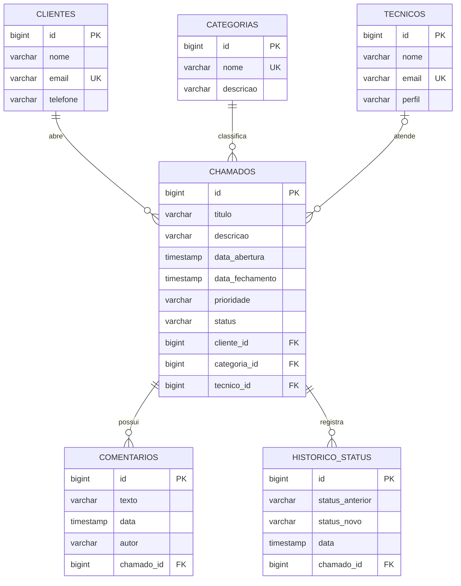
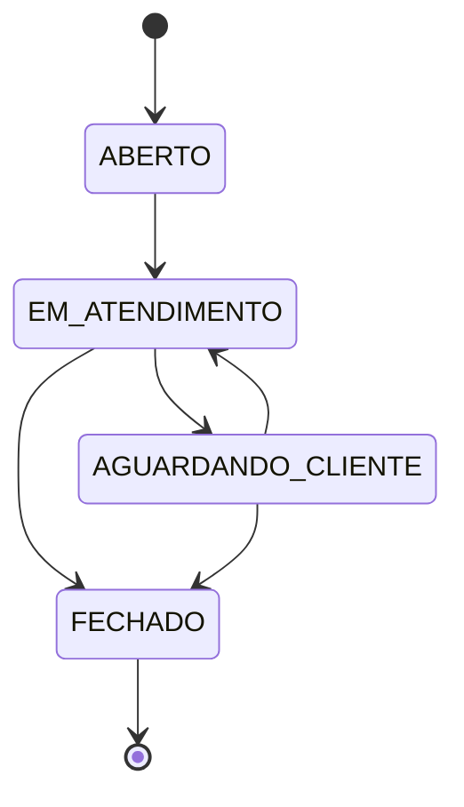

# Sistema de Chamados

API REST para cadastro e acompanhamento de chamados.

## Como executar
 Rode os seguintes comandos:
```powershell
1-cmd /c mvnw.cmd spring-boot:run
2- cmd /c mvnw.cmd spring-boot:run "-Dspring-boot.run.profiles=demo"
```

A aplicação inicia em `http://localhost:8080`. O banco usado no desenvolvimento é H2 em memória.

### Profiles

| Profile | Como ativar | O que faz |
|---|---|---|
| _(padrão)_ | `cmd /c mvnw.cmd spring-boot:run` | H2 em memória, banco vazio |
| `demo` | `cmd /c mvnw.cmd spring-boot:run "-Dspring-boot.run.profiles=demo"` | H2 com dados iniciais (2 clientes, 3 categorias, 2 técnicos, 3 chamados em status diferentes) |
| `postgres` | `cmd /c mvnw.cmd spring-boot:run "-Dspring-boot.run.profiles=postgres"` | PostgreSQL real (`application-postgres.properties`) |
| `postgres,demo` | `cmd /c mvnw.cmd spring-boot:run "-Dspring-boot.run.profiles=postgres,demo"` | PostgreSQL com dados iniciais (só insere se o banco estiver vazio) |

> No PowerShell, o argumento `-D...` precisa ficar **entre aspas**. Sem elas, o PowerShell quebra o texto
> no ponto e o Maven recebe só o pedaço `.run.profiles=demo`, falhando com `Unknown lifecycle phase`.

O profile `postgres` usa por padrão `jdbc:postgresql://localhost:5432/chamados`, usuário `postgres` e senha `postgres`.
Esses valores podem ser trocados pelas variáveis de ambiente `DB_URL`, `DB_USERNAME` e `DB_PASSWORD`.
Para subir um PostgreSQL local com Docker:

```powershell
docker run --name chamados-db -e POSTGRES_DB=chamados -e POSTGRES_PASSWORD=postgres -p 5432:5432 -d postgres:16
```

### Front-end

Com a aplicação rodando, abra `http://localhost:8080/` (dashboard). As telas ficam em
`src/main/resources/static` e são HTML + CSS + JavaScript puro, servidos pelo próprio Spring Boot,
sem build separado. O front-end não acessa o banco: cada tela só chama as rotas REST da API
(veja o mapa de telas abaixo). Para ver as telas já com dados, rode com o profile `demo`.

| Arquivo | Tela |
|---|---|
| `index.html` | Dashboard (totais por status e prioridade, chamados recentes) |
| `chamados.html` | Lista de chamados com filtros, ordenação, paginação e abertura de novo chamado |
| `chamado.html?id=` | Detalhe do chamado: alterar status, atribuir técnico, editar, excluir, comentários e histórico |
| `clientes.html` | Lista + cadastro/edição de clientes |
| `cliente.html?id=` | Detalhe do cliente e os chamados dele |
| `categorias.html` | Lista + cadastro/edição de categorias |
| `tecnicos.html` | Lista + cadastro/edição de técnicos |
| `js/app.js` | Funções compartilhadas (chamada à API, mensagens de erro, menu, formatação) |
| `js/crud.js` | Lógica genérica de lista + formulário usada por Clientes, Categorias e Técnicos |

Erros da API (400, 404 e 409) aparecem no topo da tela com a mensagem e os detalhes do `ErroResposta`.

### Documentação OpenAPI

- Swagger UI: `http://localhost:8080/swagger-ui.html`
- Especificação JSON: `http://localhost:8080/v3/api-docs`

## Rotas principais

### Clientes

- `POST /clientes`
- `GET /clientes`
- `GET /clientes/{id}`
- `PUT /clientes/{id}`
- `DELETE /clientes/{id}`

Exemplo de criação:

```json
{"nome":"Ana Souza","email":"ana@exemplo.com","telefone":"47999999999"}
```

### Categorias

- `POST /categorias`
- `GET /categorias`
- `GET /categorias/{id}`
- `PUT /categorias/{id}`
- `DELETE /categorias/{id}`

Exemplo:

```json
{"nome":"Software","descricao":"Problemas em sistemas e aplicativos"}
```

### Técnicos

- `POST /tecnicos`
- `GET /tecnicos`
- `GET /tecnicos/{id}`
- `PUT /tecnicos/{id}`
- `DELETE /tecnicos/{id}`

Exemplo:

```json
{"nome":"Carlos Lima","email":"carlos@exemplo.com","perfil":"TECNICO"}
```

Os perfis aceitos são `ADMIN` e `TECNICO`.

### Chamados

- `POST /chamados`
- `GET /chamados?status=ABERTO&prioridade=ALTA&clienteId=1&page=0&size=20&sort=dataAbertura,desc`
- `GET /chamados/{id}`
- `PUT /chamados/{id}`
- `DELETE /chamados/{id}`
- `PATCH /chamados/{id}/atribuir`
- `PATCH /chamados/{id}/status`
- `GET /chamados/{id}/historico`
- `GET /clientes/{id}/chamados`

Exemplo de criação:

```json
{
	"titulo":"Erro no sistema",
	"descricao":"Tela indisponível para o cliente",
	"prioridade":"ALTA",
	"clienteId":1,
	"categoriaId":1
}
```

Um chamado nasce com status `ABERTO` e data de abertura automática. As transições aceitas são:

- `ABERTO` para `EM_ATENDIMENTO`;
- `EM_ATENDIMENTO` para `AGUARDANDO_CLIENTE` ou `FECHADO`;
- `AGUARDANDO_CLIENTE` para `EM_ATENDIMENTO` ou `FECHADO`.

Ao fechar, a data de fechamento é preenchida. Chamados fechados não podem ser alterados.
Ao excluir um chamado, os comentários e o histórico dele também são removidos.

Exemplos de atribuição e mudança de status:

```json
PATCH /chamados/1/atribuir   {"tecnicoId":1}
PATCH /chamados/1/status     {"status":"EM_ATENDIMENTO"}
```

#### Exemplos de consulta com filtros e paginação

| Objetivo | Requisição |
|---|---|
| Todos os chamados abertos | `GET /chamados?status=ABERTO` |
| Chamados críticos de um cliente | `GET /chamados?prioridade=CRITICA&clienteId=1` |
| Abertos e de prioridade alta | `GET /chamados?status=ABERTO&prioridade=ALTA` |
| Segunda página, 5 por página | `GET /chamados?page=1&size=5` |
| Mais recentes primeiro | `GET /chamados?sort=dataAbertura,desc` |
| Chamados de um cliente | `GET /clientes/1/chamados?sort=prioridade,asc` |

Valores inválidos de `status` ou `prioridade` retornam `400 Bad Request`.

#### Histórico de status

`GET /chamados/{id}/historico` lista cada mudança de status, da abertura até o estado atual:

```json
[
  {"id":1,"statusAnterior":null,"statusNovo":"ABERTO","data":"..."},
  {"id":2,"statusAnterior":"ABERTO","statusNovo":"EM_ATENDIMENTO","data":"..."}
]
```

### Comentários

- `POST /chamados/{id}/comentarios`
- `GET /chamados/{id}/comentarios`

Exemplo:

```json
{"texto":"Estamos analisando o problema","autor":"Carlos Lima"}
```

### Dashboard

- `GET /dashboard`

Resumo da quantidade de chamados por status e por prioridade:

```json
{
  "totalChamados":3,
  "porStatus":{"ABERTO":1,"EM_ATENDIMENTO":1,"AGUARDANDO_CLIENTE":0,"FECHADO":1},
  "porPrioridade":{"BAIXA":1,"MEDIA":0,"ALTA":1,"CRITICA":1}
}
```

## Códigos de resposta

| Status | Quando acontece |
|---|---|
| 200 OK | Consulta, atualização ou mudança de status com sucesso |
| 201 Created | Criação de recurso (com cabeçalho `Location`) |
| 204 No Content | Exclusão com sucesso |
| 400 Bad Request | Bean Validation falhou, JSON malformado ou valor de enum inválido |
| 404 Not Found | ID inexistente |
| 409 Conflict | Regra de negócio violada (e-mail/nome duplicado, transição inválida, chamado fechado, exclusão de registro com chamados) |

## Modelagem

### DER implementado



Cada relação `1:N` do DER corresponde a um `@ManyToOne` no lado N
(`Chamado.cliente`, `Chamado.categoria`, `Chamado.tecnico`, `Comentario.chamado`,
`HistoricoStatus.chamado`) e, quando navegável, a um `@OneToMany(mappedBy=...)` no lado 1
(`Chamado.comentarios`). `tecnico_id` é opcional porque o chamado nasce sem técnico.

### Máquina de estados do chamado



### Mapa de telas x endpoints

| Tela | Endpoints usados |
|---|---|
| Login (futuro, não implementado) | — (depende de Spring Security) |
| Dashboard | `GET /dashboard`, `GET /chamados?size=5&sort=dataAbertura,desc` |
| Clientes – Lista / Novo / Editar / Detalhe | `GET /clientes`, `POST /clientes`, `PUT /clientes/{id}`, `GET /clientes/{id}`, `DELETE /clientes/{id}` |
| Chamados do cliente | `GET /clientes/{id}/chamados` |
| Categorias – Lista / Cadastro | `GET /categorias`, `POST /categorias`, `PUT /categorias/{id}`, `DELETE /categorias/{id}` |
| Técnicos – Lista / Cadastro | `GET /tecnicos`, `POST /tecnicos`, `PUT /tecnicos/{id}`, `DELETE /tecnicos/{id}` |
| Chamados – Lista / Filtros / Novo | `GET /chamados?status=&prioridade=&clienteId=&page=&size=&sort=`, `POST /chamados` |
| Detalhe do chamado – Status / Técnico / Comentários | `GET /chamados/{id}`, `PATCH /chamados/{id}/status`, `PATCH /chamados/{id}/atribuir`, `POST /chamados/{id}/comentarios`, `GET /chamados/{id}/historico` |

## Testes

```powershell
cmd /c mvnw.cmd test
```

| Classe | Tipo | O que cobre |
|---|---|---|
| `CategoriaRepositoryTests` | `@DataJpaTest` | Busca por ID e detecção de nome duplicado |
| `ChamadoRepositoryTests` | `@DataJpaTest` | Status inicial, filtros, paginação, contagens, e-mail duplicado de cliente |
| `ClienteControllerTests` | `@WebMvcTest` | CRUD de Cliente, 201 + Location, 400 e 404 |
| `ChamadoControllerTests` | `@WebMvcTest` | Criação, 400, 404, 409 e mudança de status |
| `ChamadosApiTests` | `@SpringBootTest` | Fluxo completo: CRUDs, regras de status, filtros, comentários, histórico, dashboard, enums inválidos e OpenAPI |

A entrega deve ser validada pelo professor antes do commit e do Pull Request.

O console do H2 fica disponível em `http://localhost:8080/h2-console`, usando JDBC URL `jdbc:h2:mem:chamadosdb`, usuário `sa` e senha em branco.
